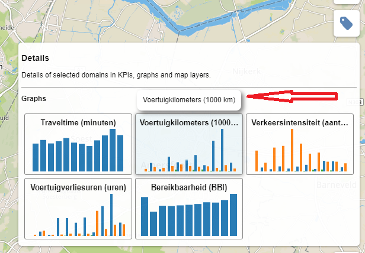

# Tooltip

Helper widget that shows tooltip.



## Architecture

The widget provides a single class *TooltipView* which represents a tooltip widget.

## API reference

### TooltipView

Extends the [L.Evented](https://leafletjs.com/reference-1.0.0.html#evented) class therefore it provides convenient subscription methods like *on(...)* and *off(...)*.

#### Usage example

```javascript
    var title = ...;
    var domElement = ...;

    // create a tooltip and specify inner HTML of the tooltip. HTML can be a string or a function returning string.
    tooltip = new TooltipView({
        html: function () { return title; }
    });

    // - show tooltip when mouse is hovers the dom element.
    // - hide tooltip when mouse is leaves the dom element.
    d3.select(domElement)
        .on('mouseover', tooltip.show)
        .on('touchstart', tooltip.show)
        .on('mouseout', tooltip.hide)
        .on('touchend', tooltip.hide);

    // when tooltip is not needed please remove it otherwise it will remain in the DOM document.
    tooltip.remove();
```

#### Options
Options object that should be passed to *TooltipView* constructor.

| Property | Type | Description |
|---|---|---|
| html | string or function | *Optional*. HTML content of the tooltip. It can be a simple string or a function that returns HTML as a string. If function is passed then it will be called each time tooltip is shown so the content of the tooltip will be always up to date. |

#### Methods <a name="methods"></a>

| Method | Description |
|---|---|
| render() | Renders the tooltip. This method is called automatically when the object is created. This method can be called in order to recreate the widget after `remove()` was called. |
| remove() | Removes the tooltip. **Note** that it is highly desired to call this function after tooltip is not needed any more because this method removes the tooltip DOM element from the DOM documnet. If this function is not called then tooltip DOM element remains present in the DOM documnet. |
| show() | Shows the tooltip. DOM element the tooltip is shown for should be passed as `this` to the function. |
| hide() | Hides the tooltip. |
